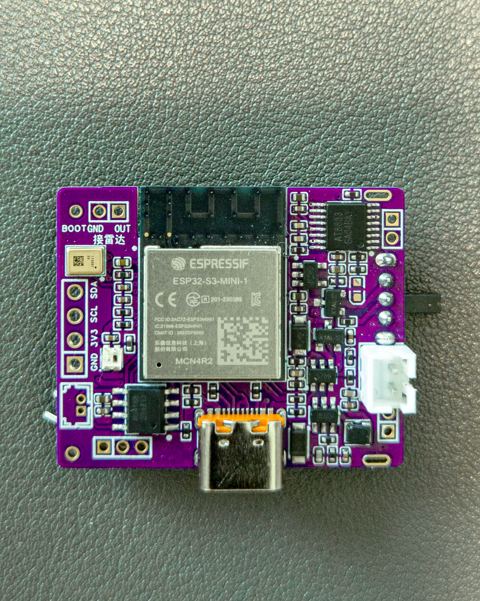
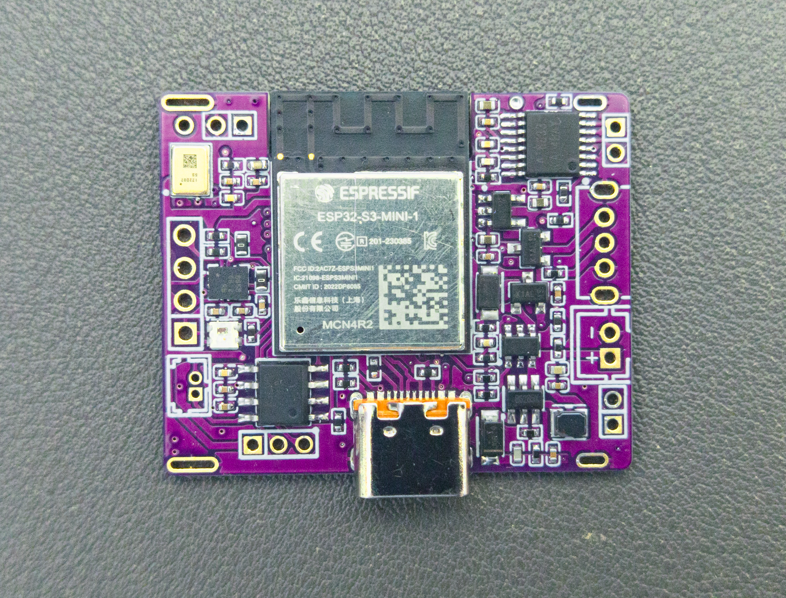

# TongDou

## Featured on Hackaday

TongDou was featured on Hackaday:

**[Tiny Desktop Robot Has Radar →](https://hackaday.com/2026/07/31/tiny-desktop-robot-has-radar/)**

Written by Zoe Skyforest · July 31, 2026

> ⚠️ **Work in Progress**
>
> TongDou is being open-sourced step by step.  
> Hardware test firmware, prototype photos, and selected hardware documents are
> public now. More hardware files, firmware, BOM, mechanical files, and build
> documentation will be released in phases.
> Please see the [Roadmap](#roadmap) below for the current release plan.

🌐 **Official website:** https://gettongdou.com

TongDou is a small desktop companion that turns ordinary reminders into
expressions, light, movement, voice, and character.

It is not a timer with a speaker. TongDou is designed to make everyday
reminders feel more human: a little expressive, a little playful, and hard to
ignore in the best possible way.

**TongDou has been physically built and is running.** It is now being
open-sourced step by step by one independent maker.

## Official Website

Follow TongDou’s development, testing program, and future crowdfunding
updates:

https://gettongdou.com

## What TongDou Demonstrates

- OLED expressions and status display
- SK6812-EC20 light effects
- Dual-motor movement
- Voice playback and scripted interactions
- Logo touch interaction
- Motion, tilt, and tap sensing
- Millimeter-wave presence detection
- A compact brass-and-PCB mechanical form

The current demonstration firmware is internal development and performance
firmware. It is shown in videos, but it is not included in this repository.
The full TongDou firmware is not public yet and will be released in a later
open-source phase.

## Hardware Platform

The new V9.4 board adds a BQ27220 fuel gauge and changes interrupt wiring.
V9.0 remains supported. Application and recovery builds use separate update
channels for each board. V9.4 fuel-gauge support is implemented; physical
validation remains pending. See [fuel-gauge integration](docs/BQ27220电量计接入.md),
[hardware details](docs/硬件说明.md) and
[firmware update instructions](docs/远程固件升级.md).

- ESP32-S3-MINI-1-N4R2
- IM72D128V01XTMA1 PDM microphone
- NS4168 I2S audio amplifier
- 0.96-inch OLED display
- SK6812-EC20 RGB LED
- AT8833CT dual-motor driver, with nFAULT connected to IO37
- QMI8658A 6-axis IMU
- TongDou logo touch input on IO4
- HLK-LD2412 millimeter-wave radar module
- TP4057 battery charging and battery monitoring

The V9 PCB is the current bring-up target. The public PCB package currently
available in this repository is still the verified v8 package; V9 manufacturing
files will be published after bring-up checks are complete.

For the currently published electrical reference documents, see the
[TongDou PCB v8 package](hardware/pcb/tongdou-pcb-v8/).

## Setup Guide for Delivered Units

For delivered units running the formal application firmware, see the
[single-page setup guide — English / 中文 / Русский](docs/tongdou-setup.html).
Download the HTML file and open it in a browser. It includes all images and
defaults to English, with a language switcher for Chinese and Russian.

The next TongDou Server runtime package is being prepared around three
versioned, prebuilt container images. Its [Linux first-start guide](tools/release_templates/server_runtime/LINUX_FIRST_START_EN.md)
and [quick start](tools/release_templates/server_runtime/QUICK_START_EN.md) describe
the planned pull-and-start flow. These files are a candidate, not a published
download; the images must be uploaded and tested before distribution. Existing
v0.1.2 server archives retain their original source-build instructions.

The separate V9.4 build for `xiaozhi.me` is documented in the
[V9.4 Xiaozhi cloud firmware guide](docs/V9.4小智云版固件.md). Its cloud pairing
and voice flow still require V9.4 hardware validation.

## Hardware Test Firmware

[Open the TongDou hardware test firmware](board_test_firmware/)

This public package is intended for hardware bring-up and diagnostics. It is
not the complete TongDou application firmware.

## V8 and V9 PCB Revisions

### V8 prototype PCB



### V9 prototype PCB



These are the real V8 and V9 prototype boards. V9 adds a capacitive touch logo
and an onboard QMI8658A 6-axis IMU.

## Open-Source Status

TongDou is a phased open-source hardware project. It does not provide a
complete manufacturing package at this stage.

### Available now

- Project overview and hardware direction
- Verified prototype status
- [Hardware test and diagnostic firmware](board_test_firmware/)
- V8 and V9 prototype PCB photos
- Existing schematic PDF files
- Existing project photos and videos
- License, attribution, and brand-use boundaries
- Hardware and documentation release plan

The hardware test firmware is not the complete TongDou application firmware.

### Not included

- Complete TongDou application firmware
- Editable PCB source files
- Gerber files
- BOM and pick-and-place files
- Mechanical source files
- Production calibration and manufacturing files
- Character behaviors
- Official audio assets
- Private data, keys, backend configuration, and service credentials

## Roadmap

### 1. Project entry

Project overview, real prototype media, demonstration video, verified status,
license information, and the public release route.

### 2. Additional hardware design materials

Existing schematic PDFs are available now. Editable PCB source files, Gerber
files, BOM, pick-and-place files, mechanical source files, and production
calibration and manufacturing files are not published yet.

Further hardware notes and validation records will be added progressively.

### 3. Original fixture and mechanical package

TongDou’s original soldering and alignment fixture, CAD and STEP files,
mechanical drawings, CNC notes, and fixture documentation.

### 4. Build and verification records

Brass-frame soldering, assembly, power-on checks, testing records, and
troubleshooting material.

Complete project materials are planned to be released progressively after the
crowdfunding campaign is complete and the first batch has shipped.

## TongDou PCB v8

The current electrical reference documents are available in
[hardware/pcb/tongdou-pcb-v8](hardware/pcb/tongdou-pcb-v8/):

- Main-control and power schematic PDFs

TongDou as a whole is still being released in phases and is not yet a complete
end-to-end manufacturing kit.

V9 hardware bring-up is in progress. V9 adds the QMI8658A motion sensor, the
TongDou logo touch input on IO4, and AT8833CT nFAULT feedback on IO37. The
V8 and V9 prototype PCB photos are now included. V9 files are not yet part of
the published manufacturing package.

## License and Attribution

Hardware design materials explicitly marked as open hardware are licensed
under [CERN-OHL-P-2.0](LICENSE). The full license text is included in this
repository.

You may use, copy, modify, manufacture, and sell hardware based on those
materials, provided that the original attribution and license notice are kept.

Recommended attribution:

```text
Based on the TongDou open-source project by solitary-dev-50
https://github.com/solitary-dev-50/tongdou
```

See [NOTICE.md](NOTICE.md) for the exact license scope, attribution rules, and
brand boundaries.

### Brand Boundary

The name “TongDou”, its logo, character design, official audio, promotional
videos, and official packaging are not granted under the hardware license.

Third parties must not present a derivative as an official TongDou product or
claim official certification or endorsement.

## Repository Documents

- [Hardware Release Package](hardware/)
- [TongDou PCB v8 Package](hardware/pcb/tongdou-pcb-v8/)
- [Hardware Test Firmware](board_test_firmware/)
- [License Scope and Attribution](NOTICE.md)

## Inspiration & Acknowledgements

TongDou's brass-and-PCB aesthetic and compact mechanical form were deeply
inspired by the incredible craftsmanship of **Huy Vector** of
**Huy Vector Lab**, particularly the desktop robot **Mo-chan**, as shown
in [this original build video](https://www.youtube.com/watch?v=3hjvpyjxPsk).

I’m a huge fan of Huy’s work and highly recommend exploring the original
projects and [Huy Vector on YouTube](https://www.youtube.com/@huyvector).

Thank you, Huy, for inspiring TongDou and for showing how beautifully brass,
PCBs, and mechanical structures can be brought to life.

TongDou’s electronics, PCB, brass frame, original soldering and alignment
fixture, firmware, character design, and interaction system were independently
developed for this project.

## Community & Contact

> **Note:** TongDou is currently a solo-maker project. To keep my focus on
> hardware development, firmware polishing, documentation, and the early
> tester program, GitHub Issues and Discussions are temporarily disabled.
>
> To follow project updates, join the waitlist, or apply for the early tester
> program, please visit the [TongDou official website](https://gettongdou.com)
> and read the [Tester Program & Agreement](https://gettongdou.com/tester-agreement.html).
>
> For essential project, media, licensing, or collaboration inquiries:
> **[hello@gettongdou.com](mailto:hello@gettongdou.com)**
>
> Thank you for your patience while I build and document TongDou step by step.
